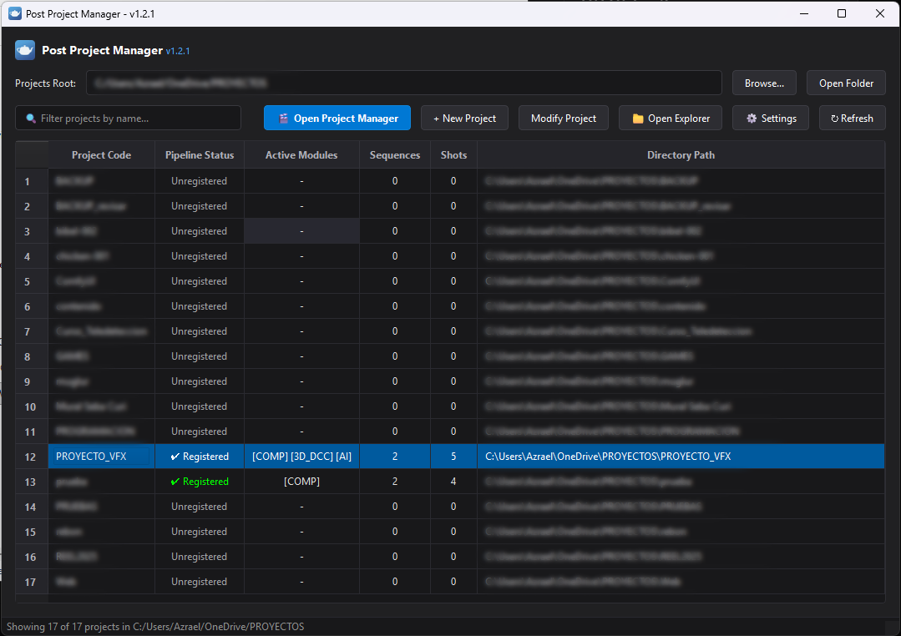
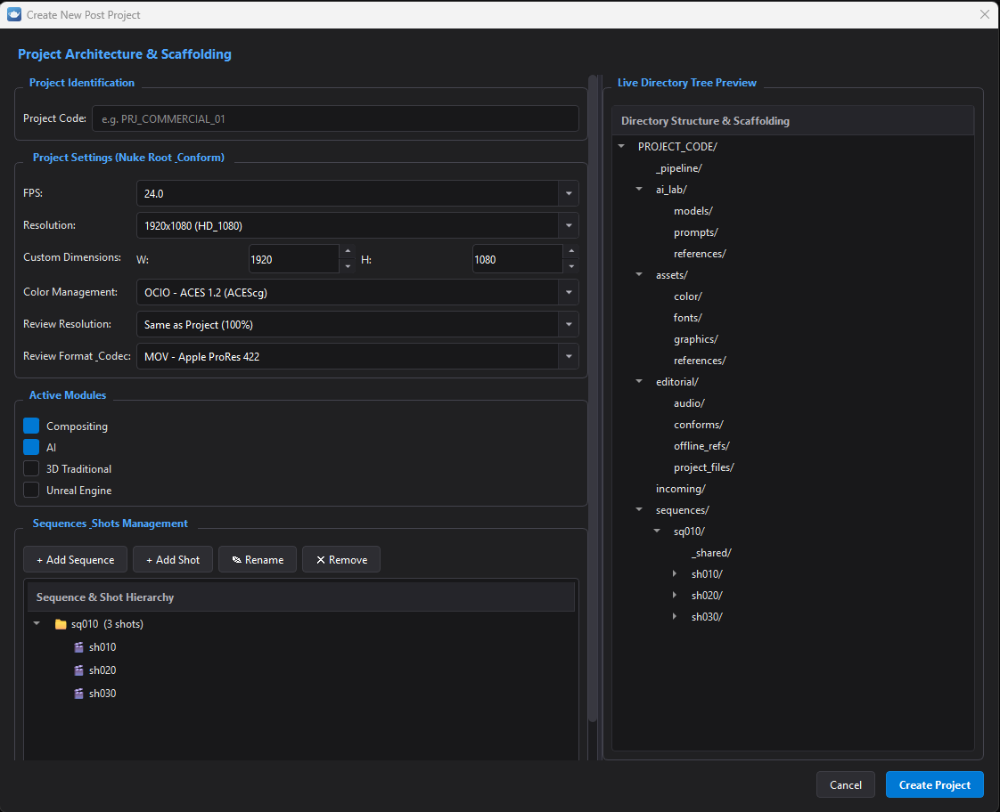
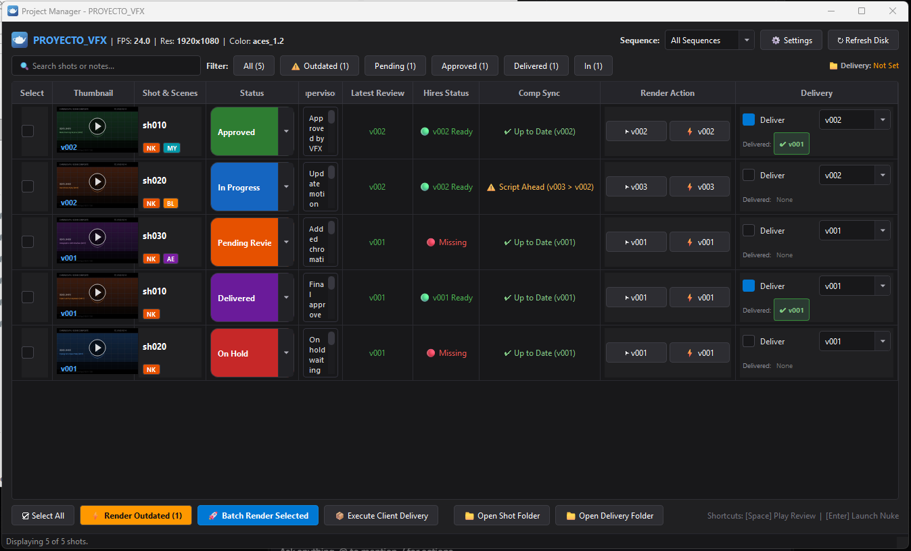
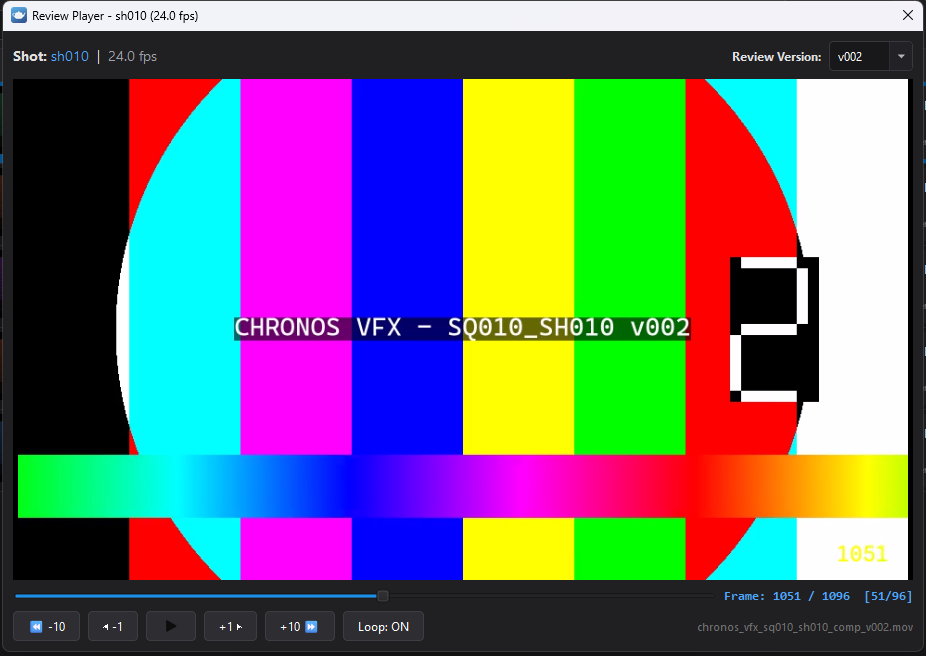

# 🫖 Post Project Manager
### *Portable Pipeline & Production Hub for VFX, Animation & Post Studios*

[](https://www.python.org/)
[](https://pypi.org/project/PySide6/)
[](https://www.foundry.com/products/nuke)
[](LICENSE)

---

## 👨‍💻 Author & Open Source Community
**Created by Cristian Fieiras** — VFX Artist  
📧 Email: [cristianfieiras@gmail.com](mailto:cristianfieiras@gmail.com)  

> [!TIP]
> **Free & Open Community Tool:**  
> This application is completely free and open. It was created out of real daily production needs to streamline workflows for freelance artists, boutique teams, and mid-sized studios.  
> **I am actively listening to ideas, feature requests, and feedback!** If you would like to collaborate, propose an enhancement, report a bug, or contribute code, feel free to open an issue, submit a pull request, or reach out directly by email.

---

## 📖 What is Post Project Manager?
**Post Project Manager** is a lightweight, high-performance desktop application that bridges the gap between directory scaffolding, visual shot tracking, visual VFX software automation, frame-accurate daily reviews, and versioned client deliveries. 

It eliminates repetitive manual setup, ensures bulletproof folder conventions, automates scene file initialization with pre-connected pipeline `Read` and `Write` nodes, and gives artists and supervisors instant real-time oversight of every shot in production.

---

## 📦 How to Download from GitHub Releases
No installation, complex environments, or admin privileges required:

1. Go to the project's **[GitHub Releases page](https://github.com/)**.
2. Download the latest pre-built portable bundle (`Post_Project_Manager_v1.0.0_win64.zip`).
3. Extract the `.zip` anywhere (e.g. `C:\Tools\PostProjectManager` or an external drive).
4. Run `PostProjectManager.exe` (or `python src/main.py` if running from source).
5. **Point to your Projects Directory:** On first launch, simply select the root directory where your studio or personal projects live. Everything is resolved relatively from that point forward!

> [!NOTE]
> **Windows SmartScreen Notice:**  
> When running the standalone executable for the first time, Windows Defender / SmartScreen may display an *"Unrecognized app"* or *"Protected your PC"* prompt. This is normal for newly released open-source software until the executable reaches ~100 runs to establish Microsoft reputation. Simply click **"More info"** and then **"Run anyway"**.

---

## 🌟 1. 100% Portable (Freelance & Studio)
- **Zero Hardcoded Paths:** Every project path is stored and resolved relatively from the selected projects root. You can safely clone, move projects to external drives, or sync over local servers and cloud storage (Dropbox, Google Drive, NAS).
- **Transparent JSON Audit & Collaborative Sync:** All project metadata, settings, sequence definitions, supervisor notes, and delivery logs are stored in plain, human-readable JSON files (`_pipeline/project_meta.json` and `_pipeline/shot_data.json`). Any project collaborator or team member can open the application from another workstation across a shared studio network drive and read/update the exact same real-time state seamlessly without requiring database servers.



---

## 🏗️ 2. Modular Scaffolding & Most Common VFX Softwares Automation
Set up a clean, scalable production architecture in seconds with visual live tree inspection:

- **Specialized Modules:**
  - 🎨 **Compositing:** Industry-standard layout for Foundry Nuke (`comp/scripts`, `comp/precomps`, `plates`, `renders`).
  - 🤖 **Full AI Workflows:** Organized inputs, custom models, and outputs for ComfyUI and GenAI tasks.
  - 🧊 **3D Traditional:** Project folders for Maya, Blender, Houdini, and Cinema 4D (`3d/scenes`, `3d/renders`, `3d/assets`).
  - ⚡ **Real-Time:** Directory structure for Unreal Engine scenes and virtual production.
- **Automated Scene & Nuke Script Generation:**
  - Automatically initializes `[project]_[sequence]_[shot]_comp_v001.nk` with project resolution, custom FPS, and OCIO color management (ACEScg / Linear).
  - Pre-populates pipeline nodes:
    - `Read` node pointing to shot plates.
    - `Write_REVIEW`: Pre-configured for daily video proxies (Apple ProRes 422 or H.264 MP4).
    - `Write_HIRES`: Pre-configured for high-resolution master frames (16-bit half OpenEXR).
- **Customizable Tree:** From the *Settings* menu, you can rename or add custom folders according to studio preferences.



### 🗂️ Standard Directory Tree Specification
```text
PROJECT_CODE/
├── _pipeline/
│   ├── history/                   # Automated backups of project metadata
│   ├── .thumbnails/               # Cinematic shot poster thumbnails
│   ├── delivery_log.json          # Audit log of client transfers
│   ├── project_meta.json          # Core project settings and active sequences
│   └── shot_data.json             # Supervisor notes, statuses, and delivery tags
├── assets/
│   ├── color/                     # LUTs, CDLs, OCIO configs
│   ├── fonts/                     # Production typography
│   ├── graphics/                  # Overlays, logos, matte paintings
│   └── references/                # Moodboards, director references
├── editorial/
│   ├── audio/                     # Temp tracks, final mixes, Foley
│   ├── conforms/                  # XML, EDL, AAF conform files
│   ├── offline_refs/              # Offline editorial reference movies
│   └── project_files/             # Premiere, DaVinci Resolve, Avid bins
├── incoming/                      # Raw client or set footage drops
├── sequences/
│   └── [SEQ_NAME]/                # e.g., sq010/
│       ├── _shared/               # Shared matte paintings and 3D assets
│       └── [SHOT_NAME]/           # e.g., sh010/
│           ├── comp/
│           │   ├── precomps/      # CG passes, keying precomps
│           │   └── scripts/       # [prj]_[seq]_[shot]_comp_v001.nk
│           ├── plates/
│           │   └── v001/          # Camera raw/ACES plates
│           │       └── proxies/   # JPG/PNG working proxies
│           ├── 3d/                # (When 3D module is active)
│           │   ├── assets/
│           │   ├── renders/
│           │   └── scenes/        # .ma, .blend, .hip files
│           ├── ai/                # (When AI module is active)
│           │   ├── inputs/
│           │   └── outputs/
│           └── renders/
│               └── [version]/     # Versioned renders (v001/, v002/)
│                   ├── hires/     # Master OpenEXR frame sequence
│                   └── review/    # Lightweight ProRes / MP4 preview video
└── delivery/                      # Configured client delivery destination
    └── [SEQ_NAME]/
        └── [SHOT_NAME]/
            └── [version]/
                ├── hires/
                └── review/
```

---

## 🛡️ 3. Safe, Non-Destructive Project Modifications
> [!IMPORTANT]
> **Additive & Safe Architecture:**  
> Productions evolve. If sequences change, shots are added/removed, or modules are toggled:
> - **Zero Data Loss:** Existing comp scripts, plate footage, and rendered EXRs are **never deleted or overwritten**.
> - **Automated Snapshots:** Metadata history is archived automatically in `_pipeline/history/project_meta_[timestamp].json`.
> - **Dynamic Setting Adaptation:** Changing resolution or color space updates project specs for all newly created shots without interfering with scripts already in progress.

---

## 📊 4. Studio Production Hub & Shot Tracker
Real-time production management table with complete shot observability:



- **Cinematic Poster Thumbnails:** Thumbnails with timecode and shot details. Click to play immediately.
- **DCC Quick-Launch Badges:** Single-click badges to open scene files in **Nuke** (`NK`), **Maya** (`MY`), **Blender** (`BL`), **Houdini** (`HP`), or **After Effects** (`AE`).
- **Visual Status Pills:** Color-coded status badges: `Approved` (Green), `In Progress` (Blue), `Pending Review` (Orange), `Delivered` (Purple), `On Hold` (Red).
- **Smart Comp Sync:** Detects when artists advance script versions: displays **`⚡ Script Ahead`** if a newer script exists that has not been rendered yet.
- **One-Click Renders:** Instant buttons to render either **Review Proxy** (`R_REV`) or **High-Res Master** (`R_HIRES`).
- **Sequential Headless Batch Render:** Background render queue running Nuke CLI (`-x` / `-X`) with live console feedback, animated progress loader, and error capture.
- **Multiline Supervisor Notes:** Word-wrapped text area with auto-save for immediate supervisor feedback.

---

## 📦 5. Automated Client Delivery Hub
- **Dedicated Client Destination:** Set up your external delivery folder (Dropbox, Google Drive, client server).
- **Shot & Version Scaffolding:** Automatically routes deliveries to clean versioned destinations:
  `[delivery]/[seq]/[shot]/[version]/[review | hires]`
- **Target Version Dropdown:** Mark shots and pick the specific version to send (`v001`, `v002`, etc.).
- **Delivered Version Tracker:** Table badge indicates which version has already been dispatched (`Delivered: ✔ v001`).
- **Pre-Transfer Verification:** Scans disk before copying. If either the high-res EXR sequence or the review video proxy is missing for that version, a warning prompt alerts you before initiating the transfer.

---

## 🎬 6. Frame-Accurate Review Player
Built-in desktop player for quick, dependency-free dailies inspection:



- **Precise Frame Stepping:** Step frame-by-frame with arrow keys or controls (`◀ -1`, `+1 ▶`, `⏪ -10`, `+10 ⏩`, Space to Play/Pause, Home/End).
- **Frame & Time Counter:** Displays real project frame numbers (`Frame: 1001 / 1100 [1/100]`) alongside duration.
- **Instant Version Switching:** Toggle between rendered versions (`v001`, `v002`, `v003`) on the fly to inspect revisions.

---

## 🚀 Wishlist & Upcoming Roadmap
- [ ] **Sequence Timeline Render / Cut Review:** One-click automated compilation that stitches all rendered shots in a sequence (or the entire project) into a single continuous editorial video file.
- [ ] **Automatic Burn-In Slate Generator:** Dynamic burned-in metadata (shot code, frame number, timecode, artist, and version) on rendered daily review movies.
- [ ] **One-Click Project Backup & Archive:** Built-in tool to package and compress an entire project or selected sequences (with options to exclude heavy caches or temp files) into a clean backup archive.
- [ ] **Automated Plate Denoising Pipeline:** Automated background denoising for ingested raw plates (using Neat Video or ML Denoisers) generating clean working plates and grain cache passes.
- [ ] **Real-Time Collaborative Multi-User Sync:** Live synchronization and conflict-free sharing of project JSON metadata across network collaborators and cloud-synced teams to keep everyone up-to-date with the latest shot changes, supervisor notes, and delivery updates.

---

## ⌨️ Keyboard Shortcuts

| Shortcut | Context | Action |
|---|---|---|
| `Space` | Review Player | Play / Pause |
| `Left / Right Arrow` | Review Player | Step ±1 Frame |
| `Shift + Left / Right` | Review Player | Step ±10 Frames |
| `Home / End` | Review Player | Jump to Start / End Frame |
| `F5` / `Ctrl + R` | Project Manager | Refresh Shots & Disk Status |
| `Ctrl + F` | Project Manager | Focus Search Filter |
| `Ctrl + B` | Project Manager | Launch Batch Render for selected shots |

---

## 🤝 Get Involved & Contributing
Do you have an idea, workflow suggestion, or would like to contribute code?  
- **GitHub Repository:** Submit PRs or open issues.
- **Direct Feedback:** Send an email to **[cristianfieiras@gmail.com](mailto:cristianfieiras@gmail.com)**.  
All ideas, feature requests, and feedback are very welcome!
